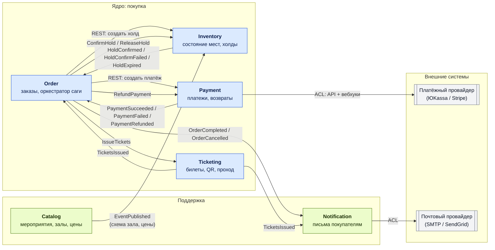

# 1. Карта контекстов

## Схема

Синхронные вызовы (REST) подписаны как «REST: …». Всё остальное — асинхронные события и команды через Kafka.

## Типы связей между контекстами (DDD)

| Связь | Тип | Пояснение |
|---|---|---|
| Catalog → Inventory | **Published Language** | Catalog публикует `EventPublished` с схемой зала. Inventory строит по нему свой «склад» мест и дальше живёт независимо |
| Order → Inventory, Payment, Ticketing | **Customer / Supplier** | Order — клиент: он диктует сценарий саги. Поставщики предоставляют API и команды, но о заказе как целом ничего не знают |
| Payment → платёжный провайдер | **Anticorruption Layer** | Модель провайдера (его статусы, форматы вебхуков) не протекает в систему. Наружу Payment отдаёт только свои события |
| Notification → Order, Ticketing | **Conformist** | Notification просто подписан на чужие события и принимает их формат как есть |

## Сервисы

### Catalog Service
**Отвечает за:** мероприятия, площадки, схемы залов (секторы, ряды, места), ценовые категории, расписание продаж.
**Данные:** `venues`, `seat_maps`, `events`, `price_categories` (PostgreSQL).
**Почему отдельно.** Это справочная часть, которую редактируют организаторы и читают все покупатели. Нагрузка — почти только чтение, её легко кэшировать (CDN, Redis). Каталог меняется редко и не участвует в покупке. Если вынести его вместе с Inventory, то при старте продаж горячие записи о местах будут мешать «холодному» чтению афиши, и наоборот — правка описания концерта будет конкурировать с бронированием.

### Inventory Service
**Отвечает за:** состояние каждого места на каждое мероприятие (`AVAILABLE → HELD → SOLD`), холды с TTL, освобождение просроченных холдов.
**Данные:** `seat_inventory (event_id, seat_id, status, hold_id, version)`, `holds (id, order_id, expires_at, status)`, outbox/inbox (PostgreSQL).
**Почему отдельно.** Именно здесь главный инвариант «одно место — один покупатель», и именно сюда приходит пиковая нагрузка в первые минуты продаж. Сервис должен масштабироваться и оптимизироваться отдельно (партиционирование по `event_id`), а его база должна быть маленькой и быстрой. Владение одним инвариантом в одном месте упрощает рассуждения о гонках.

### Order Service
**Отвечает за:** приём заказа от покупателя, хранение статуса, оркестрацию саги покупки и её компенсаций, таймауты шагов.
**Данные:** `orders (id, customer_id, event_id, seats, amount, status, idempotency_key)`, `saga_state (order_id, step, deadline, attempts)`, outbox/inbox (PostgreSQL).
**Почему отдельно.** Это единственное место, которое знает процесс покупки целиком. Если раздать логику саги по участникам, никто не будет отвечать за «заказ завис на полпути». Отдельный сервис позволяет хранить состояние саги явно, восстанавливать его после рестарта и показывать покупателю понятный статус.

### Payment Service
**Отвечает за:** создание платежа у внешнего провайдера, приём вебхуков, возвраты, сверку с провайдером.
**Данные:** `payments (id, order_id, provider_payment_id, amount, status, idempotency_key)`, `refunds`, `provider_webhook_log`, outbox/inbox (PostgreSQL).
**Почему отдельно.** Деньги — самая чувствительная часть: тут строже требования к аудиту, доступам и безопасности (PCI DSS-подобные требования). Внешний провайдер не участвует в наших транзакциях, ведёт себя по своим правилам (повторяет вебхуки, отвечает с задержкой), и это поведение нужно изолировать за ACL. Замена провайдера не должна трогать остальные сервисы.

### Ticketing Service
**Отвечает за:** выпуск билетов для оплаченного заказа, генерацию подписанных QR-кодов, погашение билета на входе.
**Данные:** `tickets (id, order_id, event_id, seat_id, qr_secret, status)` с уникальным индексом `(event_id, seat_id)` (PostgreSQL).
**Почему отдельно.** У билета свой жизненный цикл, который начинается после покупки и заканчивается на входе в зал — это другие пользователи (контролёры) и другая нагрузка (пик в час до начала мероприятия). Сканеры на входе должны работать, даже если покупка в этот момент лежит. Уникальный индекс на `(event_id, seat_id)` — вторая линия защиты от двойной продажи.

### Notification Service
**Отвечает за:** письма покупателю: «заказ оплачен, вот билеты», «оплата не прошла», «деньги возвращены».
**Данные:** `notifications (id, order_id, type, status, attempts)`, `templates` (PostgreSQL).
**Почему отдельно.** Уведомления не критичны по времени, но не должны теряться. Почтовый провайдер может тормозить или лежать — это не должно задерживать покупку. Сервис просто подписан на события и ретраит отправку сам.

### API Gateway (инфраструктура)
Не доменный сервис. Единая точка входа для веб-клиента: аутентификация (JWT), rate limiting при старте продаж, маршрутизация к Catalog, Inventory (только чтение доступности мест), Order, Ticketing и проксирование вебхуков провайдера в Payment.

## Кто чем владеет

| Данные | Владелец | Кто ещё знает (копия через события) |
|---|---|---|
| Мероприятие, схема зала, цены | Catalog | Inventory (места и цены на момент публикации) |
| Статус места, холд | Inventory | — |
| Заказ, шаг саги | Order | Notification (из событий) |
| Платёж, возврат | Payment | Order (только статус) |
| Билет, QR | Ticketing | Notification (ссылка на билет) |

Правило: **сервис не читает чужую базу**. Только API или события.

## Распределение по команде (для части 2)

| Участник | Сервисы |
|---|---|
| 1 | Order Service (сага) + API Gateway |
| 2 | Inventory Service + Catalog Service |
| 3 | Payment Service + заглушка платёжного провайдера |
| 4 | Ticketing Service + Notification Service |

Если в команде трое — участник 3 забирает ещё и Notification.
