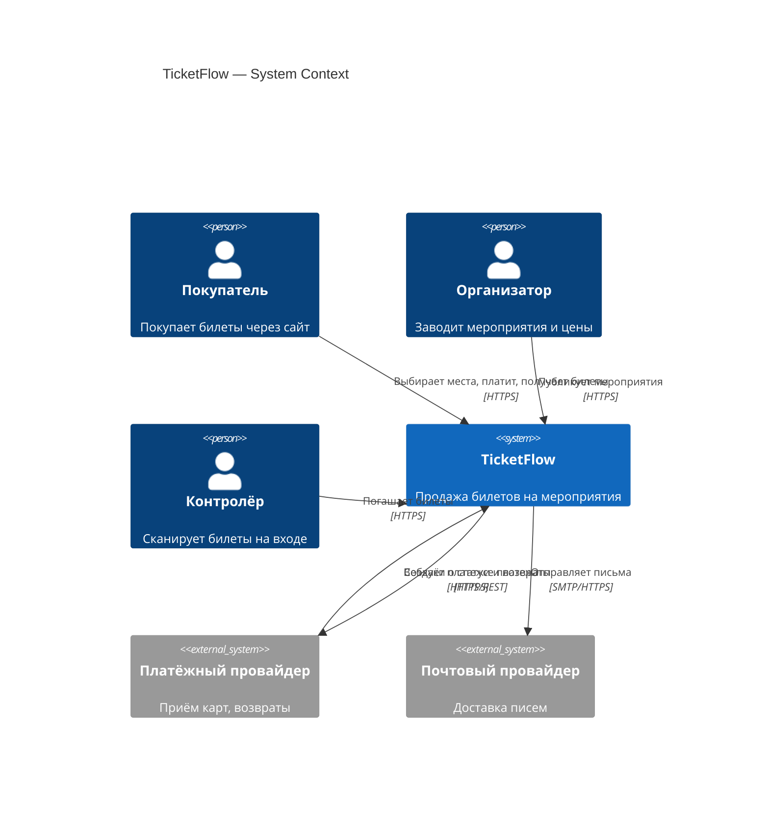
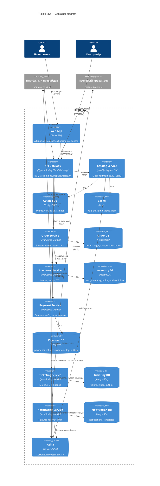

# 2. C4: уровень Container

## Контекст (Level 1) — кратко

## Container (Level 2)

> Вебхуки провайдера приходят через Gateway, который проксирует их на `POST /webhooks/psp` в Payment Service. Gateway пропускает этот путь без JWT, проверку подписи делает Payment.

## Контейнеры

| Контейнер | Технология | Масштабирование | Комментарий |
|---|---|---|---|
| API Gateway | Nginx / Spring Cloud Gateway | горизонтально | Rate limit на `POST /orders` при старте продаж |
| Catalog | сервис + PostgreSQL + Redis | горизонтально, read-heavy | Афишу можно отдавать из кэша |
| Order | сервис + PostgreSQL | горизонтально | Состояние саги в БД, сервис stateless |
| Inventory | сервис + PostgreSQL | горизонтально, партиции по `event_id` | Горячая точка при старте продаж |
| Payment | сервис + PostgreSQL | 2+ реплики | Изолирован сетевыми политиками |
| Ticketing | сервис + PostgreSQL | горизонтально | Пик за час до начала мероприятия |
| Notification | сервис + PostgreSQL | 1–2 реплики | Не критичен по времени |
| Kafka | 3 брокера, `replication.factor=3`, `min.insync.replicas=2` | — | Ключ сообщения = `orderId` |

## Топики Kafka

| Топик | Кто пишет | Кто читает |
|---|---|---|
| `catalog.events` | Catalog | Inventory |
| `inventory.commands` | Order | Inventory |
| `inventory.events` | Inventory | Order |
| `payment.commands` | Order | Payment |
| `payment.events` | Payment | Order |
| `ticketing.commands` | Order | Ticketing |
| `ticketing.events` | Ticketing | Order, Notification |
| `order.events` | Order | Notification |

Подробная схема сообщений — в [AsyncAPI](03-contracts/asyncapi/ticketflow-events.yaml).
