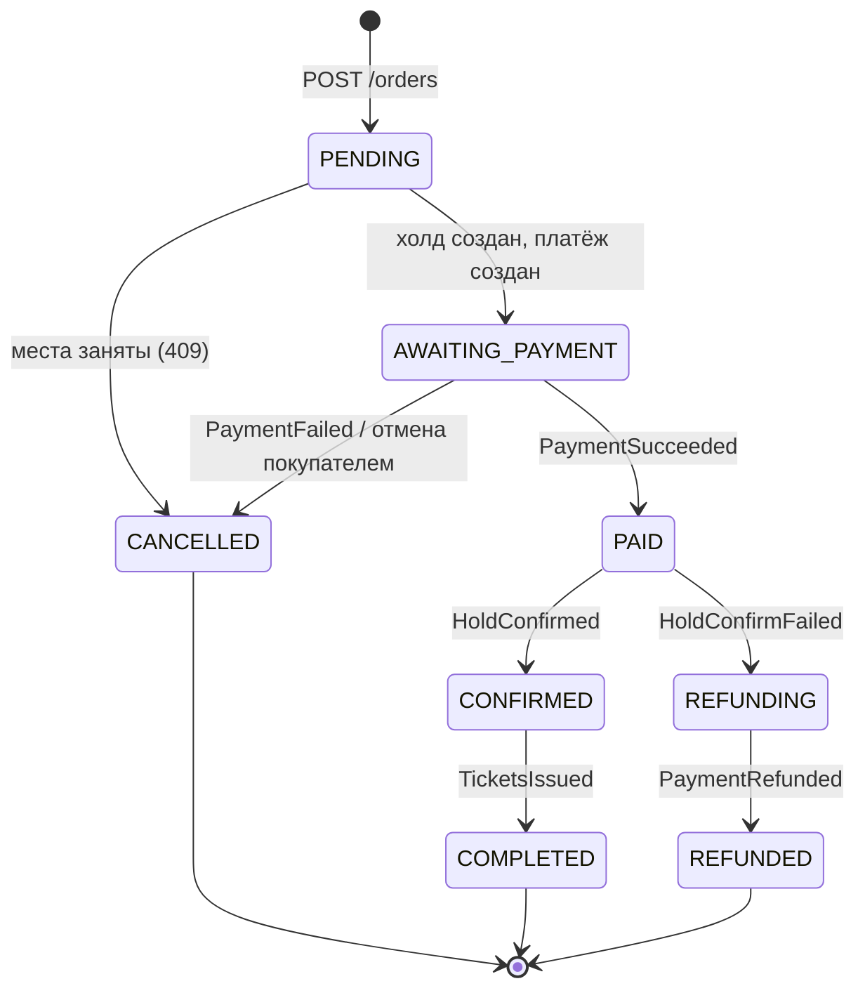
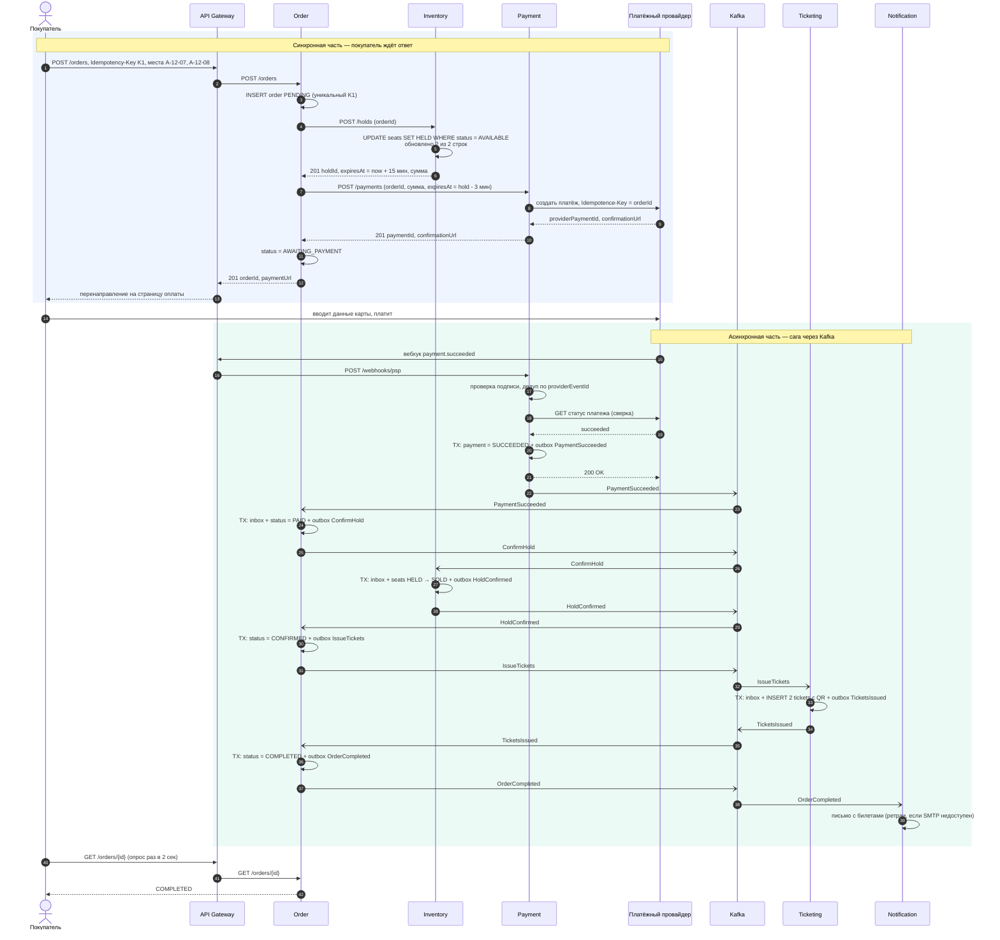
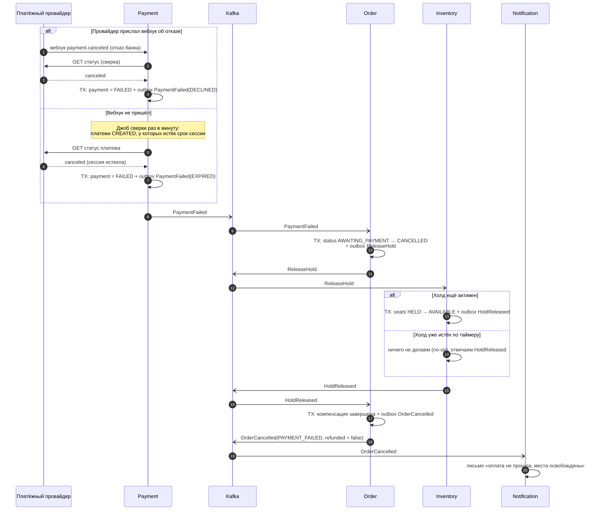
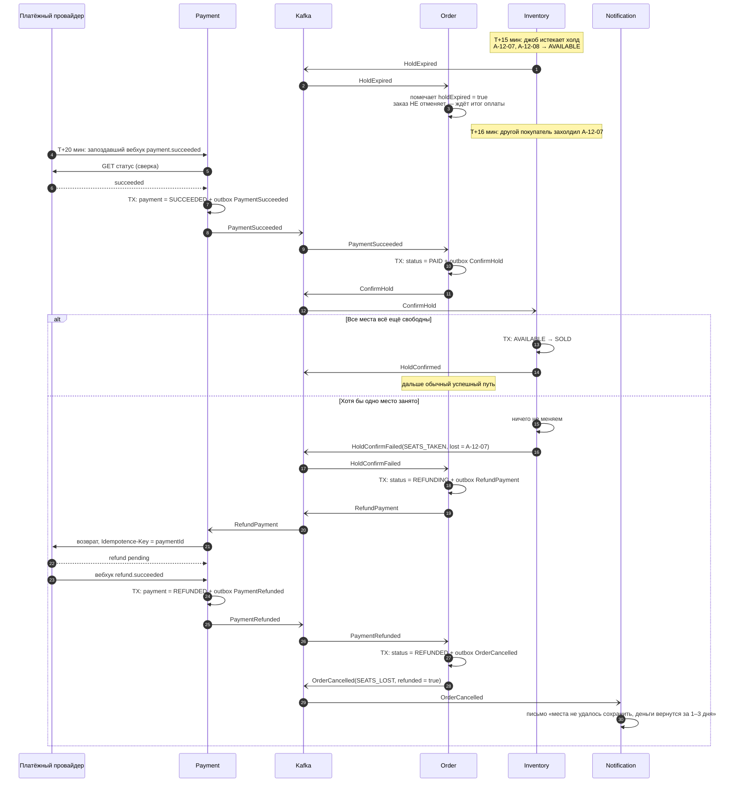
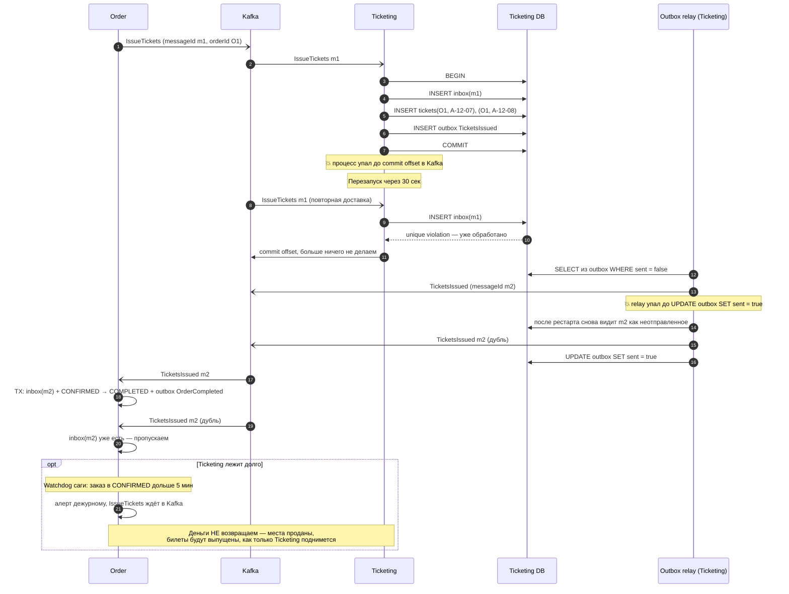

# 4. Главный процесс: покупка билета

Покупка — это **оркестрированная сага**: Order Service ведёт процесс по шагам и при сбое запускает компенсации (см. [ADR-002](05-adr/ADR-002-saga-orchestration.md)).

| Шаг | Участник | Действие | Компенсация |
|---|---|---|---|
| 1 | Inventory | Захолдить места (AVAILABLE → HELD, TTL 15 мин) | `ReleaseHold` — освободить места |
| 2 | Payment | Создать платёж у провайдера, покупатель платит | `RefundPayment` — вернуть деньги |
| 3 | Inventory | Подтвердить холд (HELD → SOLD) | — (если не вышло, компенсируем шаг 2) |
| 4 | Ticketing | Выпустить билеты | Не компенсируется — **только вперёд**: повторяем, пока не выпустим |
| 5 | Notification | Письмо покупателю | Не компенсируется — повторяем |

Шаг 3 — **поворотная точка** (pivot): до неё сагу можно откатить, после неё — только довести до конца. Места проданы и деньги получены, поэтому сбои в шагах 4–5 лечатся повторами, а не возвратом денег.

## Состояния заказа

Каждый переход — одна локальная транзакция в Order DB: обновить `orders.status` + записать следующую команду в `outbox`. Переход разрешён только из ожидаемого состояния (`UPDATE ... WHERE status = 'PAID'`), поэтому повторное событие не продвинет сагу второй раз.

---

## 4.1. Успешный сценарий

**Что здесь важно:**
- Каждый «TX» — локальная транзакция одного сервиса. Изменение данных и запись события в outbox коммитятся вместе, поэтому событие не теряется, даже если сервис упадёт сразу после коммита (ADR-003).
- Payment не верит телу вебхука, а сверяет статус запросом к провайдеру: вебхук можно подделать.
- Срок платёжной сессии на 3 минуты короче холда, чтобы покупатель физически не мог заплатить за уже освобождённые места. Но вебхук всё равно может опоздать — это сценарий сбоя 2.

---

## 4.2. Сбой 1: оплата не прошла (или вебхук потерялся)

**Что ломается.** Банк отклонил карту, или покупатель закрыл страницу оплаты. Места захолжены, деньги не списаны. Хуже вариант: провайдер так и не прислал вебхук, и мы не знаем, чем кончилась оплата.

**Как компенсируем.** Освобождаем места (`ReleaseHold`), заказ → `CANCELLED`. Если вебхука нет — Payment сам опрашивает провайдера (сверка), поэтому окончательный статус всё равно будет получен.

**Гарантии:** места вернутся в продажу самое позднее через 15 минут (TTL холда) — даже если Order и Payment оба лежат. `ReleaseHold` идемпотентен: повтор или освобождение уже истёкшего холда ничего не ломает.

---

## 4.3. Сбой 2: деньги списаны, а места уже проданы другому

**Что ломается.** Покупатель заплатил в последнюю секунду, но вебхук задержался у провайдера на 20 минут. За это время холд истёк, места вернулись в продажу и их захолдил другой покупатель. У нас деньги без мест — худший случай.

**Как компенсируем.** Inventory пытается продать места, даже если холд истёк (вдруг они ещё свободны). Если хотя бы одно занято — `HoldConfirmFailed`, и Order запускает компенсацию шага 2: **возврат денег**.

**Гарантии:**
- Место не продано дважды: подтверждение в Inventory — условный `UPDATE` только из `HELD` своего холда или из `AVAILABLE`.
- Деньги не потеряны: из `REFUNDING` заказ выходит только по `PaymentRefunded`. Если провайдер не отвечает — `RefundPayment` ретраится с тем же ключом, второй возврат не создастся.
- Если возврат не прошёл за 24 часа — алерт в поддержку (ручной разбор).

---

## 4.4. Сбой 3: Ticketing упал посередине, сообщения пришли дважды

**Что ломается.** Места проданы, деньги получены, Order отправил `IssueTickets`. Ticketing записал билеты в базу и упал, не успев подтвердить сообщение в Kafka. После рестарта Kafka доставит `IssueTickets` ещё раз. Плюс outbox-relay мог отправить `TicketsIssued` и упасть до отметки «отправлено» — Order получит событие дважды.

**Как компенсируем.** Здесь компенсации нет — мы уже после поворотной точки, отменять покупку нельзя. Вместо этого **forward recovery**: повторяем, а идемпотентность гарантирует, что повтор не создаст дублей.

**Гарантии:**
- Два билета на одно место невозможны: inbox отсекает повтор сообщения, а уникальный индекс `tickets(event_id, seat_id)` — даже если inbox по ошибке пропустит.
- Команда не теряется: Kafka хранит её, пока консьюмер не подтвердит обработку.
- Order не продвинет сагу дважды: inbox + переход только из ожидаемого статуса.

---

## Сводка: что где может сломаться

| Сбой | Где | Реакция | Тип |
|---|---|---|---|
| Место уже занято при холде | Inventory, синхронно | 409 покупателю, заказ не создаётся | отказ |
| Payment/PSP недоступен при создании платежа | шаг 2, синхронно | 503 покупателю, `ReleaseHold`, покупатель повторяет с тем же ключом | компенсация |
| Отказ в оплате / вебхук потерян | шаг 2 | `ReleaseHold`, `CANCELLED` (**сбой 1**) | компенсация |
| Оплата прошла после истечения холда | шаг 3 | `RefundPayment`, `REFUNDED` (**сбой 2**) | компенсация |
| Ticketing / Notification упал, дубли сообщений | шаги 4–5 | ретрай + идемпотентность (**сбой 3**) | forward recovery |
| Order упал посреди саги | любой | состояние в БД, после рестарта читает Kafka с последнего offset | восстановление |
| Kafka недоступна | любой | события копятся в outbox, relay дошлёт | восстановление |
